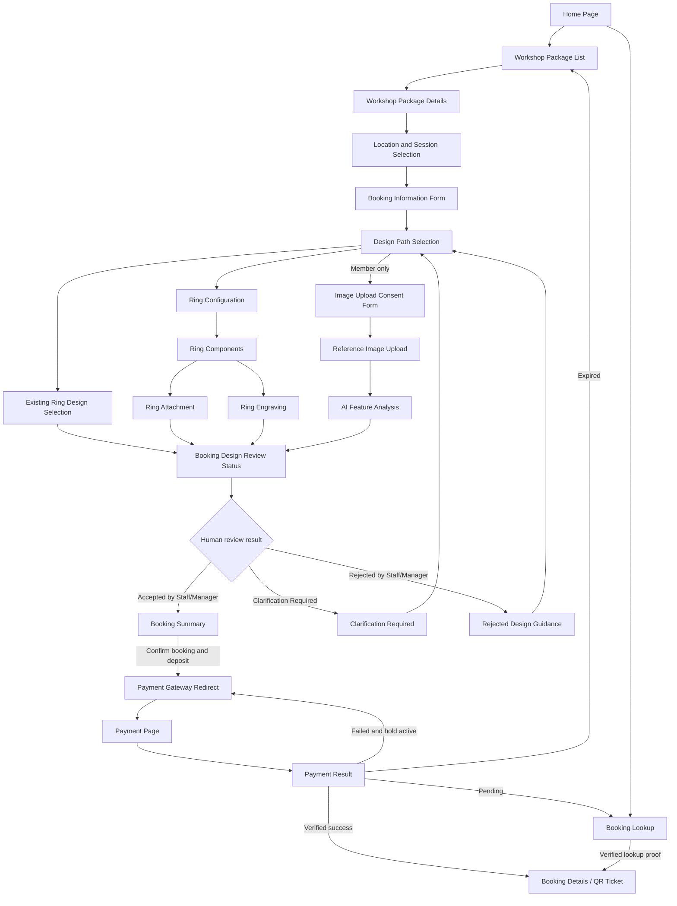

#### a. Screen Flow

<!-- This part shows the system screens and the relationship among screens. -->

The diagram uses the following rules:

- A package, location, session, and booking information are selected before the design path.
- Guest may use existing/configured design paths but cannot enter the consent, upload, or AI-analysis branch.
- Every valid image-analysis request reaches Staff or Manager review. AI never creates an Accepted or Rejected business decision.
- `Clarification Required` and `Rejected` return to a new design version; an old decision cannot be reused after a material design change.
- `Booking Details / QR Ticket` is reachable only after verified payment success. Browser return alone is not payment confirmation.
- `Booking Lookup` is an independent entry path for pending or confirmed bookings; it is not a mandatory step after Booking Summary.
