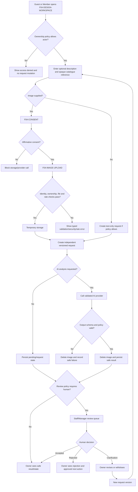

# Feature-04 Design: Independent AI Design Workspace

**Date created**: 2026-10-24  
**Date updated**: 2026-10-28  
**Author**: Ngô Tiến Đạt  
**Last updated by**: Ngô Tiến Đạt  

**Feature**: `004-ai-chatbox-analysis-and-suggestion`  
**Status**: Independent-flow design handoff; ownership decisions remain a gate  
**Design baseline**: [`ppswbs-spec/DESIGN.md`](../../DESIGN.md)

## 1. Design objective and boundary

Feature-04 provides a standalone AI Design Workspace. It is not a step in the
Workshop Booking flow and must not render package, branch, session, booking,
summary or payment screens as prerequisites. Booking and payment may link to a
completed design result later through their own contracts, but Feature-04 does not
call or mutate those modules.

The three use cases are:

1. Guest/Member Basic AI Support for public information.
2. Independent Design Request with optional description and/or reference image,
   AI analysis and the approved human-review policy.
3. Manager advisory price suggestion for a new catalogue proposal.

## 2. Ownership gate

The handoff has not yet approved whether Guest can create a Design Request, how a
Guest retrieves their own request, whether text-only requests are valid, or whether
all requests require human review. Screens and API states must therefore show these
as configurable policy gates rather than inventing booking-based eligibility.

## 3. Screen inventory

| ID | Screen | Actor | Required behavior |
| --- | --- | --- | --- |
| `F04-AI-CHAT` | Basic AI Chat | Guest/Member | Public-scope prompt, bilingual response, advisory label, rate/error/retry states. |
| `F04-DESIGN-WORKSPACE` | Independent Design Workspace | Guest/Member after approved ownership gate | Start request, enter optional description, select optional opaque catalogue reference, upload optional image. No booking fields. |
| `F04-CONSENT` | Image Consent | Approved image-request actor | Shows purpose, consent version, retention statement and affirmative action before storage. |
| `F04-IMAGE-UPLOAD` | Reference Image Upload | Approved image-request actor | Validates MIME/signature, 10 MB, 4096×4096, metadata, malware policy and three-per-five-minute quota. |
| `F04-ANALYSIS-STATUS` | Analysis Status | Request owner | Shows pending, processing, failed, awaiting review, clarification and retry/revision actions. |
| `F04-RESULT` | Design Result | Request owner | Shows safe candidate features, image quality, confidence/uncertainty, human decision and next action. Never shows raw provider payload. |
| `F04-REVIEW-QUEUE` | Review Queue | Staff/Manager | Scope-limited independent requests; no branch/session/package columns unless they are unrelated operational scope fields approved by the design. |
| `F04-REVIEW-DETAIL` | Review Detail | Staff/Manager | Safe result, request version, owner-safe identity, decision controls, reason and stale/conflict states. |
| `F04-PRICE-PROPOSAL` | Manager Price Proposal | Manager | New package/product proposal, advisory AI suggestion, manual fallback and Manager decision. Catalogue publication is a separate handoff. |
| `F04-ADMIN-AUDIT` | Technical/Audit Evidence | Admin | Correlation, schema, provider failure and deletion evidence only; no commercial suggestion details by default. |

## 4. Independent screen flow

No node in this flow calls booking, payment, capacity, ticket, location or session
services.

## 5. API-to-screen mapping

| API | Screens | Required state behavior |
| --- | --- | --- |
| `POST /api/v1/ai-support/messages` | `F04-AI-CHAT` | Guest may call only public scope; invalid Bearer token is not downgraded to Guest. |
| `POST /api/v1/design-requests` | Workspace, Consent, Upload | Independent description/image input; no booking fields; ownership policy is server-side. |
| `GET /api/v1/design-requests/{id}` | Status, Result | Owner-safe projection; cross-owner access is denied without enumeration. |
| `GET /api/v1/design-review-requests` | Review Queue | Staff/Manager scope only. |
| `POST /api/v1/design-review-requests/{id}/decisions` | Review Detail | Version, authority, conflict and reason validation. |
| Price suggestion endpoints | Manager Price Proposal, Admin Audit | Manager sees commercial advisory data; Admin sees technical projection; no automatic publication. |

## 6. UI states and accessibility

Every screen must define loading, empty, validation, forbidden, rate-limited,
provider-timeout, failure, stale-version, concurrent-conflict and retry states.
Customer-facing screens are mobile-first; operational screens are desktop-first.
All actions must have keyboard access, visible focus, bilingual labels, text status
beside color and no raw image/provider payload exposure.

## 7. Traceability and implementation gate

The implementation must trace independent Design Request requirements to `spec.md`,
`data-model.md`, OpenAPI, tasks and tests. Do not start backend or frontend code
until Guest ownership, text-only requests, review policy, withdrawal/revision and
image-retention decisions are approved. The previous booking-dependent screens and
flow are retired, not adapted as a hidden prerequisite.
