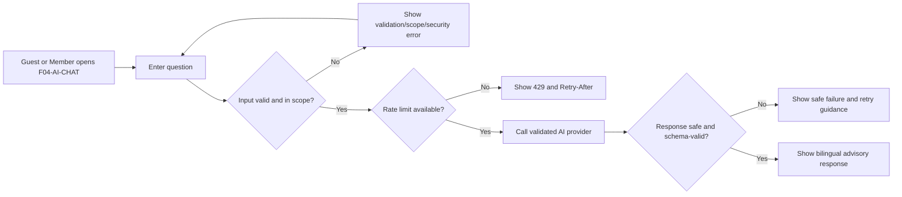
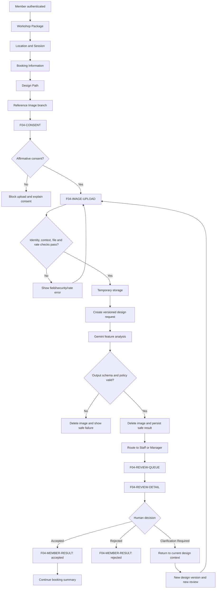
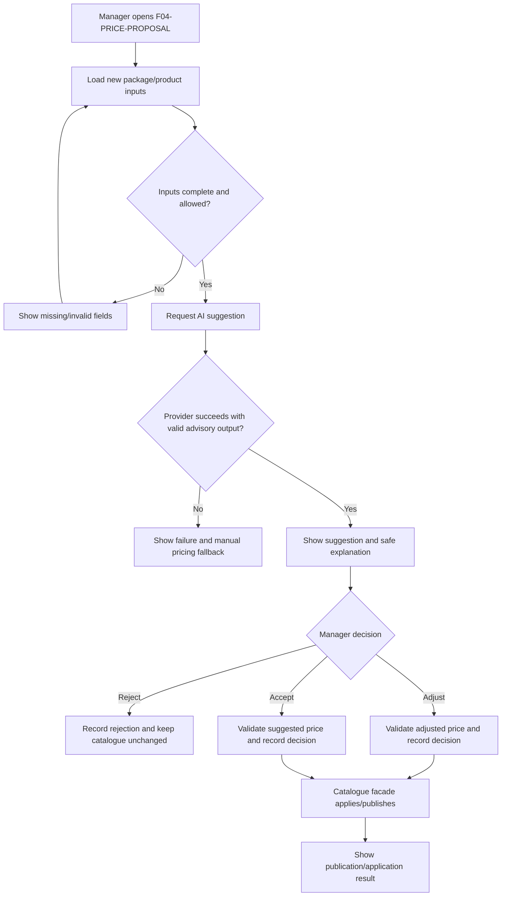

# Feature-04 Design: AI Chatbox Analysis and Suggestion

**Date created**: 2026-10-24
**Date updated**: 2026-10-24
**Author**: Ngô Tiến Đạt
**Last updated by**: Ngô Tiến Đạt

**Feature**: `004-ai-chatbox-analysis-and-suggestion`
**Status**: Draft design handoff
**Design baseline**: [`ppswbs-spec/DESIGN.md`](../../DESIGN.md)

## 1. Design objective, scope and sources

This design defines the observable screens, transitions, permissions and UI states
for Feature-04. It is implementation-ready for the React + Vite client while
preserving business ownership in the Spring Boot REST modules.

The feature contains three use cases:

1. Guest or Member asks Basic AI Support about approved public information.
2. An authenticated Member submits a temporary booking-design image for AI feature
   analysis and receives the result after Staff or Manager review.
3. An authorized Manager requests an advisory price suggestion for a new workshop
   package or retail product.

Configured ring-design choices are outside this feature. They belong to the
booking/ring-design contract and must not be rendered as another input mode of
`POST /api/v1/design-requests`.

### Sources of truth

| Concern | Source |
| --- | --- |
| Business scope, actors, invariants and acceptance scenarios | [`spec.md`](spec.md) |
| REST routes, inputs, outputs and access summary | [`APIs.md`](../../APIs.md), [`ai-chatbox-analysis.openapi.yaml`](contracts/ai-chatbox-analysis.openapi.yaml) |
| Technical boundaries and delivery slices | [`plan.md`](plan.md) |
| Logical ownership and state records | [`data-model.md`](data-model.md) |
| Visual tokens, components, page patterns and accessibility | [`DESIGN.md`](../../DESIGN.md) |
| Project role, source precedence and design gates | [`AGENT.md`](../../AGENT.md) |

Business rules in `spec.md` override visual convenience. This file does not create
new booking, payment, catalogue, custom-manufacturing or accounting behavior.

## 2. Resolved decisions and design dependencies

| Decision | Design rule |
| --- | --- |
| Physical role mapping | Display and permission logic use `Manager` and `Admin`. Technical authorization maps them to `OWNER` and `ADMIN_TECHNICAL` respectively without expanding authority. |
| Basic AI actors | Guest and Member only. Staff, Manager and Admin do not use the Feature-04 Basic AI endpoint. |
| Booking-design input | Image upload only. Member consent is required before storage or provider processing. |
| Input limits | Prompt maximum 2,000 characters; image maximum 10 MB; image dimensions maximum 4096×4096; provider timeout 30 seconds. |
| Image rate limit | Three image-submission attempts per authenticated Member in a rolling five-minute window; fourth attempt shows `429 IMAGE_RATE_LIMITED` and `Retry-After`. |
| AI evidence | Member sees structured, policy-filtered image quality, candidate features, confidence/uncertainty and safe explanation. Raw provider payload is never shown. |
| Human review | Every valid image request reaches Staff or Manager review. AI never creates a business decision. |
| Price visibility | Manager sees the full advisory suggestion and explanation. Admin sees only approved technical/audit evidence. Staff, Guest and Member see no internal suggestion. |
| Frontend | React + Vite, mobile-first for customer journeys and desktop-first for operations. No Feature-04 Thymeleaf/htmx screen. |

The following remain external implementation dependencies and do not block this
design: Gemini model/version and credentials, provider billing approval, physical
schema/migration mapping, MFA recovery mechanism, deployment, SLA and production
quality targets.

## 3. Actor and permission design

| Actor | Screens | Allowed actions | Forbidden actions |
| --- | --- | --- | --- |
| Guest | `F04-AI-CHAT` | Ask supported public-information questions. | Upload image, view design result, view price suggestion, make business decisions. |
| Member | `F04-AI-CHAT`, `F04-CONSENT`, `F04-IMAGE-UPLOAD`, `F04-ANALYSIS-STATUS`, `F04-MEMBER-RESULT` | Ask Basic AI Support; submit an image for own eligible booking after consent; view own result. | Review requests, view another Member's data, view internal price suggestion. |
| Staff | `F04-REVIEW-QUEUE`, `F04-REVIEW-DETAIL` | Review in-scope requests at or below 3,000,000 VND; record an allowed decision. | Basic AI endpoint, price suggestion, out-of-scope request, self-review or conflict review. |
| Manager | `F04-REVIEW-QUEUE`, `F04-REVIEW-DETAIL`, `F04-PRICE-PROPOSAL` | Review higher-value/Manager-authority requests; request and decide advisory package/product price suggestions. | Review outside authority, self-review, direct AI publication or direct payment/booking mutation. |
| Admin | `F04-ADMIN-AUDIT` | Inspect approved technical/audit evidence and manage technical configuration through approved interfaces. | Business review decision, final catalogue price decision, price publication or booking/payment mutation. |
| AI provider | No user screen | Receive only normalized allowlisted input and return validated candidate/advisory output. | Mutate Mland business state or decide review/price/booking/payment status. |
| Cloud storage | No user screen | Temporarily store and delete booking-design input. | Permanent booking-design image retention. |

All protected screens must use backend authorization. Client route guards are a
usability layer only and never replace Firebase verification, Mland role/status,
ownership, branch/delegation or authority checks.

## 4. Screen inventory

| ID | Screen | Actor | Purpose and required content |
| --- | --- | --- | --- |
| `F04-AI-CHAT` | Basic AI Chat | Guest, Member | Prompt field, supported-topic hint, bilingual response, advisory disclaimer, loading state, safe error and retry. No private context or transaction action. |
| `F04-PACKAGE-CONTEXT` | Workshop Package Context | Guest/Member | Displays the selected workshop package and published information before the booking context continues. Owned by booking/catalogue flow; referenced here only as context. |
| `F04-LOCATION-SESSION-CONTEXT` | Location and Session Context | Guest/Member | Displays selected branch/location and session. The selected values are read-only context for image eligibility. |
| `F04-BOOKING-CONTEXT` | Booking Information Context | Guest/Member | Displays the booking information needed to identify the eligible Member booking. No image upload occurs here. |
| `F04-DESIGN-PATH` | Design Path | Guest/Member | Shows available design paths from the owning booking/ring-design contract. The Feature-04 branch is `Reference Image`; configured design choice is linked out, not implemented here. |
| `F04-CONSENT` | Image Consent Form | Member | Shows purpose-specific paid Gemini analysis consent, consent version, retention statement, privacy link and affirmative action. Continue is disabled until consent is affirmative. |
| `F04-IMAGE-UPLOAD` | Reference Image Upload | Member | Multipart image selection, preview before processing, 10 MB/4096×4096 constraints, allowed file feedback, remove/reselect and submit. Do not expose image after processing. |
| `F04-ANALYSIS-STATUS` | Analysis and Review Status | Member | Shows upload accepted, processing, analysis failure, awaiting human review, clarification required and retry/revise actions. |
| `F04-MEMBER-RESULT` | Member Analysis Result | Member | Shows structured safe evidence, AI/advisory warning, human review decision, reason when safe, next action and the distinction from final design/price. |
| `F04-REVIEW-QUEUE` | Human Review Queue | Staff/Manager | Scope-limited list with value, branch, package/session, analysis state, review state, age and required action. No raw image or provider payload. |
| `F04-REVIEW-DETAIL` | Human Review Detail | Staff/Manager | Shows safe analysis projection, current design version, estimate snapshot, review authority, decision controls, mandatory reason and conflict/stale state. |
| `F04-PRICE-PROPOSAL` | Manager Price Proposal | Manager | Shows validated package/product inputs, request suggestion, advisory result, explanation, warning, manual price fallback and accept/adjust/reject controls. |
| `F04-ADMIN-AUDIT` | Technical/Audit Evidence | Authorized Admin | Shows correlation ID, provider status, schema version, failure evidence, deletion outcome and timestamps. It does not show full price suggestion or raw provider payload. |

The booking context remains package-first:

```text
Workshop Package
→ Location and Session
→ Booking Information
→ Design Path
→ Booking Summary
→ Payment
```

Feature-04 inserts consent, upload, analysis and human-review status into the
`Reference Image` branch before the booking flow can use the safe result. It does
not confirm payment or create a booking by itself.

## 5. Mermaid screen flows

### 5.1 Basic AI Support



### 5.2 Booking-design image analysis and human review



### 5.3 Manager price suggestion



## 6. API-to-screen and state mapping

| API | Primary screens | Request validation state | Success state | Failure/recovery state |
| --- | --- | --- | --- | --- |
| `POST /api/v1/ai-support/messages` | `F04-AI-CHAT` | Empty/over-2,000, unsupported topic, private-data request, prompt injection, rate limit | Validated advisory response | `AI_INPUT_INVALID`, `AI_SCOPE_UNSUPPORTED`, `AI_CONTEXT_NOT_ALLOWED`, `AI_PROMPT_INJECTION_DETECTED`, `AI_RATE_LIMITED`, `AI_UNAVAILABLE`, `AI_OUTPUT_POLICY_VIOLATION` with retry or safe exit |
| `POST /api/v1/design-requests` | `F04-CONSENT`, `F04-IMAGE-UPLOAD` | Member identity, consent, booking ownership, design version, MIME/signature, 10 MB, 4096×4096, malware, rate limit and idempotency | `202` request with `PENDING`/`PROCESSING` status | `401`, `403`, `409`, `422`, `429`; preserve entered context where safe and do not store image on rejection |
| `GET /api/v1/design-requests/{id}` | `F04-ANALYSIS-STATUS`, `F04-MEMBER-RESULT`, `F04-REVIEW-DETAIL` | Ownership/scope and current projection | Safe analysis/review projection | `NOT_FOUND`, `REVIEW_NOT_AUTHORIZED`, stale version and provider failure display |
| `GET /api/v1/design-review-requests` | `F04-REVIEW-QUEUE` | Staff/Manager role, active status and branch/delegation scope | Scoped queue | Empty queue, forbidden scope, retryable unavailable state |
| `POST /api/v1/design-review-requests/{id}/decisions` | `F04-REVIEW-DETAIL` | Authority threshold, current version, no conflict/self-review, valid decision/reason | Atomic human decision | `REVIEW_NOT_AUTHORIZED`, `DESIGN_VERSION_STALE`, `REVIEW_STATE_CONFLICT`, validation error |
| `POST /api/v1/price-proposals/{id}/ai-suggestions` | `F04-PRICE-PROPOSAL` | Manager authority, new package/product, complete pricing context, no private data | Advisory suggestion with warning | Invalid/incomplete input, provider timeout, invalid suggestion; manual Manager fallback |

The UI must not infer business status from HTTP `200` alone. It renders the
explicit analysis state and review state returned by the API. `ACCEPTED` is a
human review outcome and does not mean payment or booking confirmation.

## 7. Shared UI states and recovery

| State | Presentation | Allowed action |
| --- | --- | --- |
| Loading | Skeleton or progress indicator with a stable status message and disabled duplicate submit. | Wait, cancel where the API supports cancellation, or return safely. |
| Empty | Explain that no result/review request is available and show the next valid action. | Start a new eligible flow or return to context. |
| Validation error | Inline field message plus summary for form-level errors; bilingual message key. | Correct the field and retry. |
| Permission denied | Do not reveal resource existence or private data; explain the actor cannot perform the action. | Return to allowed screen. |
| Rate limited | Show `IMAGE_RATE_LIMITED` or `AI_RATE_LIMITED`, `Retry-After` and safe retry time. | Wait; do not auto-loop requests. |
| Provider timeout/unavailable | Keep business state unchanged, show correlation-safe recovery message and manual fallback where defined. | Retry idempotently or use Manager manual pricing fallback. |
| Invalid provider output | Show safe failure; never display raw output. | Retry same version where allowed or route to human clarification. |
| Stale version | Explain that the design changed or a newer decision exists. | Reload current version and create a new version when material changes occur. |
| Review conflict | Explain that another reviewer completed the decision. | Reload queue/detail; do not overwrite the decision. |
| Success | Show next action and advisory/human-controlled labels. | Continue the owning booking or catalogue workflow. |

## 8. Component, layout and interaction rules

- Use the color, typography, spacing, radius, button, input, card, badge, table,
  modal and toast tokens from `DESIGN.md`; do not introduce feature-only tokens.
- Customer screens use the focused form/wizard pattern. Keep one primary CTA,
  the current booking step and the next required decision visible on mobile.
- Review queue uses the operational collection/table pattern. On narrow screens,
  prioritize request ID, value, branch, review state and action; expose remaining
  details in the detail screen rather than forcing a dense table.
- Review detail uses a two-region desktop layout: safe analysis/context summary
  and decision panel. On mobile, stack the decision panel after the evidence.
- Price proposal uses a form/detail pattern. Separate input snapshot, AI advisory
  result, Manager decision and catalogue publication result visually.
- Consent is a blocking form, not a passive notice. The affirmative action must be
  explicit and the consent version/purpose must be visible before upload.
- Destructive or irreversible actions use confirmation and explain the business
  consequence. AI suggestions never use language such as “confirmed”, “final” or
  “approved” unless that is the recorded human decision.
- Status colors must also have text labels and remain understandable in monochrome.
- Do not use raw provider JSON, raw image payload, provider token, Firebase token or
  unnecessary PII as visible UI content.

## 9. Responsive, bilingual and accessibility behavior

### Responsive

- Customer journeys are mobile-first and remain usable on touch screens.
- Staff/Manager operations are desktop-first and remain usable at 1366×768; tables
  collapse to prioritized columns or a stacked detail view on smaller screens.
- Upload controls support touch selection and keyboard activation. Progress and
  error messages remain visible without relying on hover.
- Dialogs are reserved for short consent/confirmation decisions; long review or
  price forms use pages or drawers according to the applicable `DESIGN.md` pattern.

### Bilingual content

- Every visible label, validation error, status, consent statement and recovery
  message uses a stable bilingual message key.
- Technical identifiers such as `IMAGE_RATE_LIMITED` may appear in audit detail but
  are paired with user-facing Vietnamese/English text.
- Keep terminology consistent: `booking-design`, `custom-manufacturing`,
  `candidate feature`, `advisory suggestion`, `human review` and `clarification required`.

### Accessibility

- Every input has a visible label, helper text where needed and an associated error.
- Focus order follows the workflow; dialogs trap focus and return focus to the
  triggering control.
- Async status changes use an appropriate live region without repeatedly interrupting
  screen-reader users.
- Color is never the only indicator of review, analysis or payment-related status.
- Upload, consent, retry and decision controls are keyboard-operable with visible focus.

## 10. Traceability

| Requirement/scenario | Design coverage |
| --- | --- |
| FR-04-001 to FR-04-005, Basic AI scope and retention | `F04-AI-CHAT`, Basic AI flow, API/state mapping |
| FR-04-006 to FR-04-009, Member consent and temporary image | `F04-CONSENT`, `F04-IMAGE-UPLOAD`, booking-design flow |
| FR-04-010 to FR-04-013, safe AI output and human review | `F04-ANALYSIS-STATUS`, `F04-MEMBER-RESULT`, `F04-REVIEW-DETAIL` |
| FR-04-014 to FR-04-017, Staff/Manager review authority | `F04-REVIEW-QUEUE`, `F04-REVIEW-DETAIL`, permission matrix |
| FR-04-018 to FR-04-022, advisory price suggestion | `F04-PRICE-PROPOSAL`, Manager price flow |
| FR-04-023 to FR-04-025, input and output security | Shared validation/error states and safe evidence rule |
| FR-04-026 to FR-04-028, atomic image rate limit/idempotency | `F04-IMAGE-UPLOAD`, rate-limit and retry states |
| FR-04-029, price suggestion visibility | `F04-PRICE-PROPOSAL`, `F04-ADMIN-AUDIT`, actor matrix |
| Acceptance scenarios 1–6 | `F04-AI-CHAT` and Basic AI flow |
| Acceptance scenarios 7–16 | Consent, upload, analysis, review and Member result flows |
| Price scenarios 1–6 | Manager price flow and manual fallback |

## 11. Design acceptance checklist

- [ ] All screens use React + Vite and the visual baseline from `DESIGN.md`.
- [ ] Basic AI is available only to Guest and Member.
- [ ] Configured design choice is not represented as a Feature-04 upload mode.
- [ ] Consent is affirmative, purpose-specific and blocking before image upload.
- [ ] Image constraints show 10 MB and 4096×4096 limits.
- [ ] Prompt input shows the 2,000-character limit.
- [ ] Three-attempt/five-minute rate limiting and `Retry-After` are represented.
- [ ] Analysis status and review status are visually separate.
- [ ] Member sees only structured safe evidence, never raw provider output.
- [ ] Every valid image request reaches Staff/Manager human review.
- [ ] Staff/Manager threshold, branch/delegation and conflict states are visible.
- [ ] Price suggestion is visible only to authorized Manager, with Admin audit scope.
- [ ] AI suggestion cannot be presented as final price, booking confirmation or payment confirmation.
- [ ] Loading, empty, validation, denied, timeout, retry, stale and conflict states exist.
- [ ] Customer screens are mobile-first; operational screens support 1366×768 and mobile fallback.
- [ ] Bilingual labels/messages and keyboard/screen-reader requirements are covered.
- [ ] No raw image, credential, token, raw provider payload or unnecessary PII is displayed.

## 12. Verification and handoff

The design handoff is complete when:

1. `spec.md`, `APIs.md`, `plan.md` and this file agree on actors, routes, limits,
   frontend baseline and scope.
2. Every screen in the inventory has an owning actor, API/state source and recovery
   behavior.
3. Every acceptance scenario maps to a screen flow or explicitly documented
   backend-only behavior.
4. Markdown links and Mermaid blocks are readable, and `git diff --check` passes.
5. Remaining infrastructure TBDs are recorded as dependencies and are not silently
   converted into UI or business decisions.

This document is a design handoff, not implementation approval. Code and tests may
begin only after the feature spec, API contract, data model, plan, tasks and design
are reviewed under the project workflow.
