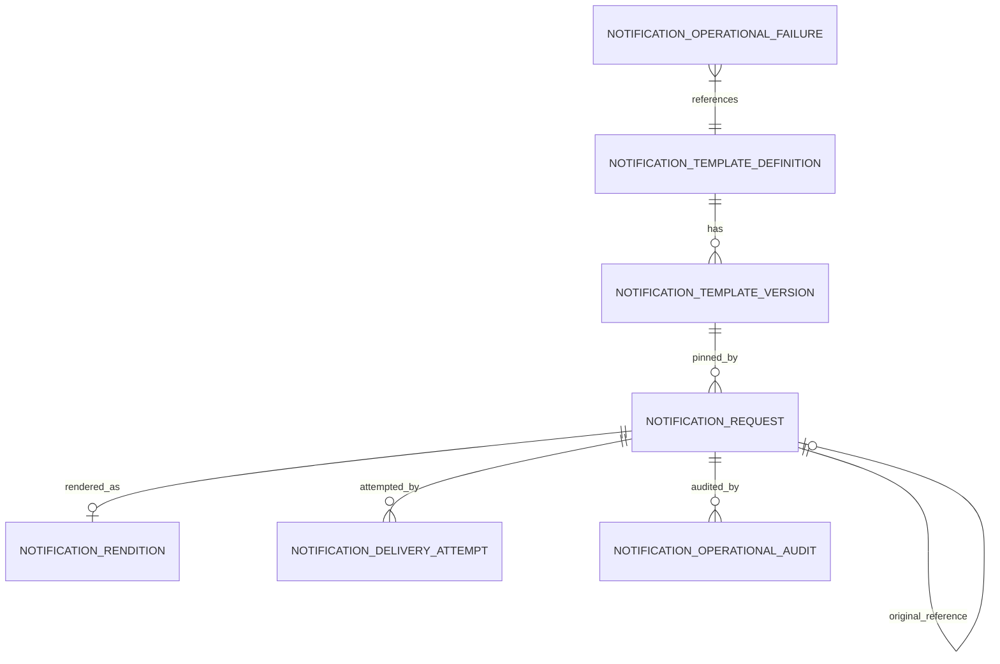
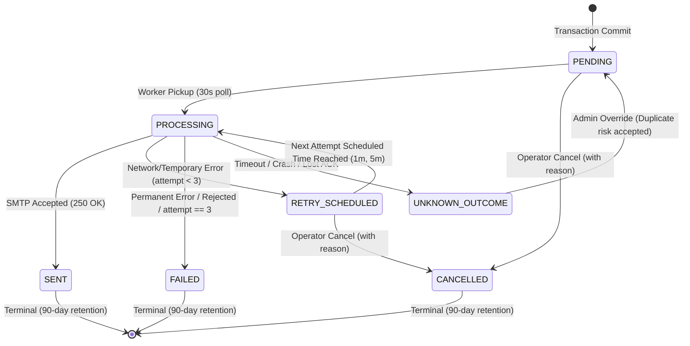
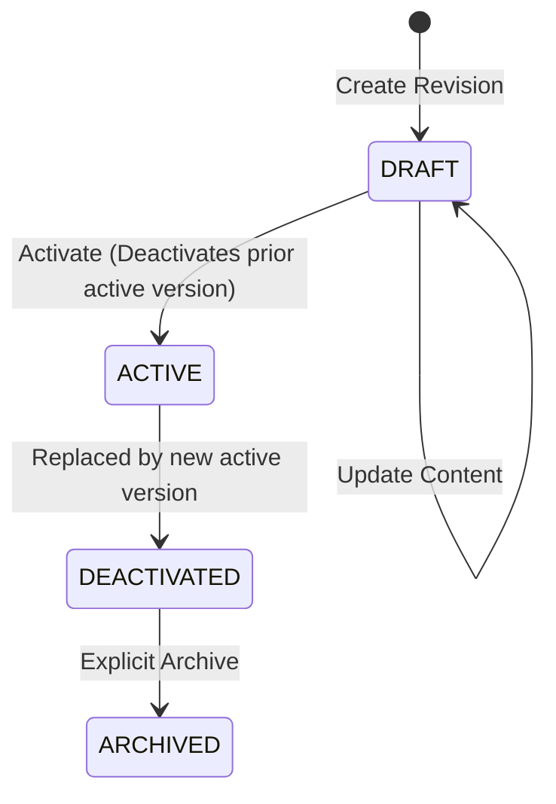

# Data Model: FE-007 Notification Management

**Date created**: 2026-11-06
**Date updated**: 2026-11-06
**Author**: Phan Sơn
**Last updated by**: Phan Sơn

**Feature**: [spec.md](spec.md) | **Plan**: [plan.md](plan.md)

## 1. Overview & Ownership

Feature FE-007 (`notificationmanagement`) owns all transactional email persistence, template definitions, immutable versions, notification requests, rendered outputs, delivery attempts, operational failures, audit records, and minimized tombstones.

Feature FE-007 **does not own**:
- Booking records, pricing, or ticket generation (owned by `workshopbooking`).
- Retail orders or inventory state (owned by `readyringsales`).
- User authentication, password reset, or email verification (owned by Firebase Auth & `accountmanagement`).
- Credential generation, rotation, or revocation (owned by source features).

## 2. Entity Relational Diagram

---

## 3. Entity Definitions

### 3.1. `notification_template_definition` (Template Definition)
Canonical registry of email types registered by business features.

| Column | Type | Nullable | Default | Description / Constraints |
|---|---|---|---|---|
| `id` | BIGINT AUTO_INCREMENT | NO | PK | Surrogate identifier |
| `code` | VARCHAR(64) | NO | | Unique template code (e.g. `BOOKING_CONFIRMED`, `RETAIL_ORDER_CONFIRMED`, `AUTH_EMAIL_VERIFICATION`) |
| `name` | VARCHAR(128) | NO | | Human-readable name for dashboard |
| `description` | VARCHAR(255) | YES | | Purpose and context of the template |
| `owning_module` | VARCHAR(64) | NO | | Owning module identifier (`workshopbooking`, `readyringsales`, `firebase_auth`) |
| `lifecycle_status` | VARCHAR(32) | NO | `'DRAFT'` | Enum: `EXTERNAL`, `DRAFT`, `ELIGIBLE`, `ACTIVE`, `DEACTIVATED`, `ARCHIVED` |
| `allowed_placeholders` | TEXT (JSON) | NO | | JSON Array of allowed placeholder strings (e.g. `["customerName", "bookingCode", "depositAmount"]`) |
| `created_at` | DATETIME(6) | NO | CURRENT_TIMESTAMP(6) | Creation timestamp |
| `updated_at` | DATETIME(6) | NO | CURRENT_TIMESTAMP(6) | Last update timestamp |

**Indexes & Constraints**:
- `uq_ntd_code`: `UNIQUE(code)`

---

### 3.2. `notification_template_version` (Template Version)
Immutable draft, active, or historical presentation revision for one template definition.

| Column | Type | Nullable | Default | Description / Constraints |
|---|---|---|---|---|
| `id` | BIGINT AUTO_INCREMENT | NO | PK | Surrogate identifier |
| `template_definition_id` | BIGINT | NO | FK | References `notification_template_definition(id)` |
| `version_number` | INT | NO | | Incrementing integer revision per template definition |
| `subject_template` | VARCHAR(255) | NO | | Email subject line with `{{placeholder}}` syntax |
| `html_template` | MEDIUMTEXT | NO | | HTML body with `{{placeholder}}` syntax |
| `plain_text_template` | MEDIUMTEXT | NO | | Plain text body fallback with `{{placeholder}}` syntax |
| `status` | VARCHAR(32) | NO | `'DRAFT'` | Enum: `DRAFT`, `ACTIVE`, `DEACTIVATED`, `ARCHIVED` |
| `created_by` | VARCHAR(64) | NO | | Account ID of author |
| `activated_by` | VARCHAR(64) | YES | | Account ID of activating Admin/Manager |
| `activated_at` | DATETIME(6) | YES | | Timestamp when activated |
| `created_at` | DATETIME(6) | NO | CURRENT_TIMESTAMP(6) | Version creation timestamp |
| `updated_at` | DATETIME(6) | NO | CURRENT_TIMESTAMP(6) | Last update timestamp |

**Indexes & Constraints**:
- `fk_ntv_definition`: `FOREIGN KEY (template_definition_id) REFERENCES notification_template_definition(id)`
- `uq_ntv_def_version`: `UNIQUE(template_definition_id, version_number)`
- **Invariant**: Exactly zero or one row with `status = 'ACTIVE'` per `template_definition_id` at any time.

---

### 3.3. `notification_request` (Notification Request)
Durable, idempotent record of one requested business email, pinning template version, recipient, and business snapshot.

| Column | Type | Nullable | Default | Description / Constraints |
|---|---|---|---|---|
| `id` | BIGINT AUTO_INCREMENT | NO | PK | Surrogate identifier |
| `business_event_reference` | VARCHAR(128) | NO | | Source business event ID (e.g. `BOOKING-20261106-001`, `ORDER-10023`) |
| `template_code` | VARCHAR(64) | NO | | Code of template used |
| `template_version_id` | BIGINT | NO | FK | Pinned version, references `notification_template_version(id)` |
| `recipient_role` | VARCHAR(32) | NO | `'CUSTOMER'` | Fixed role: `CUSTOMER` (V1) |
| `recipient_address_fingerprint` | VARCHAR(64) | NO | | SHA-256 hex hash of trimmed, lowercased recipient email |
| `recipient_address_masked` | VARCHAR(128) | NO | | Masked email for safe support display (e.g., `a***b@domain.com`) |
| `recipient_snapshot` | TEXT | NO | | JSON payload with full recipient details (subject to 90-day retention scrub) |
| `business_data_snapshot` | MEDIUMTEXT | NO | | Frozen JSON key-value map matching template placeholders |
| `artifact_reference` | VARCHAR(255) | YES | | Safe non-credential reference to ticket/QR artifact or deep link |
| `credential_reference` | VARCHAR(255) | YES | | Reference or short-lived credential token (scrubbed on expiry/revocation) |
| `credential_expires_at` | DATETIME(6) | YES | | Expiration timestamp of the credential reference if applicable |
| `delivery_state` | VARCHAR(32) | NO | `'PENDING'` | State: `PENDING`, `PROCESSING`, `RETRY_SCHEDULED`, `SENT`, `FAILED`, `UNKNOWN_OUTCOME`, `CANCELLED` |
| `attempt_count` | INT | NO | 0 | Number of completed SMTP attempts (max 3) |
| `next_attempt_at` | DATETIME(6) | YES | | Earliest time for next delivery attempt |
| `processing_started_at` | DATETIME(6) | YES | | Timestamp worker picked up this request |
| `smtp_invocation_started_at`| DATETIME(6) | YES | | Timestamp immediately before `JavaMailSender.send()` is called |
| `terminal_at` | DATETIME(6) | YES | | Timestamp when request reached terminal state (`SENT`, `FAILED`, `CANCELLED`) |
| `original_request_id` | BIGINT | YES | FK | Self-reference to root request if this is a resend/redelivery |
| `created_at` | DATETIME(6) | NO | CURRENT_TIMESTAMP(6) | Request creation timestamp |
| `updated_at` | DATETIME(6) | NO | CURRENT_TIMESTAMP(6) | State modification timestamp |

**Indexes & Constraints**:
- `fk_nr_version`: `FOREIGN KEY (template_version_id) REFERENCES notification_template_version(id)`
- `fk_nr_original`: `FOREIGN KEY (original_request_id) REFERENCES notification_request(id)`
- `uq_nr_idempotency`: `UNIQUE(business_event_reference, template_code, recipient_role, recipient_address_fingerprint, original_request_id)` (Null `original_request_id` enforces exactly one original request per business event/recipient).
- `idx_nr_worker_poll`: `INDEX(delivery_state, next_attempt_at, id)` (Used by 30s poll-based worker query).
- `idx_nr_retention`: `INDEX(terminal_at, delivery_state)` (Used by 90-day retention scrub job).

---

### 3.4. `notification_rendition` (Rendered Content)
The rendered subject, HTML, and plain text produced during first delivery attempt. Frozen and reused on retry/resend.

| Column | Type | Nullable | Default | Description / Constraints |
|---|---|---|---|---|
| `id` | BIGINT AUTO_INCREMENT | NO | PK | Surrogate identifier |
| `notification_request_id` | BIGINT | NO | FK | References `notification_request(id)` |
| `rendered_subject` | VARCHAR(255) | NO | | Concrete subject string |
| `rendered_html` | MEDIUMTEXT | NO | | Concrete HTML body |
| `rendered_plain_text` | MEDIUMTEXT | NO | | Concrete plain text body |
| `rendered_at` | DATETIME(6) | NO | CURRENT_TIMESTAMP(6) | Rendition generation timestamp |

**Indexes & Constraints**:
- `uq_nrd_request`: `UNIQUE(notification_request_id)`
- `fk_nrd_request`: `FOREIGN KEY (notification_request_id) REFERENCES notification_request(id)`

---

### 3.5. `notification_delivery_attempt` (Delivery Attempt Log)
Records each physical SMTP invocation attempt for diagnostics and audit.

| Column | Type | Nullable | Default | Description / Constraints |
|---|---|---|---|---|
| `id` | BIGINT AUTO_INCREMENT | NO | PK | Surrogate identifier |
| `notification_request_id` | BIGINT | NO | FK | References `notification_request(id)` |
| `attempt_number` | INT | NO | | 1, 2, or 3 |
| `started_at` | DATETIME(6) | NO | | Timestamp when invocation began |
| `completed_at` | DATETIME(6) | NO | | Timestamp when response/error was caught |
| `outcome_category` | VARCHAR(32) | NO | | `SUCCESS`, `NETWORK_TEMPORARY`, `REJECTED_PERMANENT`, `TIMEOUT`, `UNKNOWN` |
| `provider_message_id` | VARCHAR(128) | YES | | Message-ID returned by SMTP server (if accepted) |
| `safe_error_summary` | VARCHAR(512) | YES | | Sanitized error code/summary (PII and secrets redacted) |

**Indexes & Constraints**:
- `fk_nda_request`: `FOREIGN KEY (notification_request_id) REFERENCES notification_request(id)`
- `idx_nda_request_attempt`: `INDEX(notification_request_id, attempt_number)`

---

### 3.6. `notification_operational_failure` (Operational Failure Record)
Persisted when an enqueue attempt cannot create a valid `notification_request` (e.g. inactive template, invalid recipient, missing required placeholder) without rolling back the business transaction.

| Column | Type | Nullable | Default | Description / Constraints |
|---|---|---|---|---|
| `id` | BIGINT AUTO_INCREMENT | NO | PK | Surrogate identifier |
| `business_event_reference` | VARCHAR(128) | NO | | Business event reference from source feature |
| `template_code` | VARCHAR(64) | NO | | Template code requested |
| `recipient_fingerprint` | VARCHAR(64) | YES | | SHA-256 hash of recipient email if provided |
| `failure_code` | VARCHAR(64) | NO | | `TEMPLATE_INACTIVE`, `TEMPLATE_NOT_FOUND`, `REQUIRED_PLACEHOLDER_MISSING`, `INVALID_RECIPIENT` |
| `safe_reason` | VARCHAR(512) | NO | | Diagnostic description without PII |
| `created_at` | DATETIME(6) | NO | CURRENT_TIMESTAMP(6) | Enqueue attempt timestamp |

**Indexes & Constraints**:
- `idx_nof_event`: `INDEX(business_event_reference, template_code)`

---

### 3.7. `notification_operational_audit` (Operational Audit Record)
Audits manual operator actions (resend, cancellation, redelivery, or unknown outcome override).

| Column | Type | Nullable | Default | Description / Constraints |
|---|---|---|---|---|
| `id` | BIGINT AUTO_INCREMENT | NO | PK | Surrogate identifier |
| `notification_request_id` | BIGINT | NO | FK | References `notification_request(id)` |
| `actor_account_id` | VARCHAR(64) | NO | | Account ID of Admin/Manager performing action |
| `actor_role` | VARCHAR(32) | NO | | `ADMIN` or `MANAGER` |
| `action_type` | VARCHAR(64) | NO | | `RESEND`, `CANCEL`, `REDELIVER_REFRESHED_CREDENTIAL`, `OVERRIDE_UNKNOWN_OUTCOME` |
| `reason` | VARCHAR(512) | NO | | Mandatory operational justification provided by operator |
| `previous_state` | VARCHAR(32) | NO | | Request state prior to action |
| `new_state` | VARCHAR(32) | NO | | Request state resulting from action |
| `duplicate_risk_accepted` | BOOLEAN | NO | FALSE | True only if Admin explicitly accepted duplicate send risk |
| `created_at` | DATETIME(6) | NO | CURRENT_TIMESTAMP(6) | Audit timestamp |

**Indexes & Constraints**:
- `fk_noa_request`: `FOREIGN KEY (notification_request_id) REFERENCES notification_request(id)`
- `idx_noa_actor`: `INDEX(actor_account_id, created_at)`

---

### 3.8. `notification_tombstone` (Minimized Retained Record)
Created when a notification request exceeds the 90-day retention threshold; original sensitive payload/rendition is deleted, leaving minimal metadata for 12 months.

| Column | Type | Nullable | Default | Description / Constraints |
|---|---|---|---|---|
| `id` | BIGINT AUTO_INCREMENT | NO | PK | Surrogate identifier |
| `original_request_id` | BIGINT | NO | | Former `notification_request(id)` |
| `business_event_reference` | VARCHAR(128) | NO | | Business event reference |
| `template_code` | VARCHAR(64) | NO | | Template code |
| `terminal_state` | VARCHAR(32) | NO | | `SENT`, `FAILED`, `CANCELLED` |
| `attempt_count` | INT | NO | | Total attempts performed |
| `request_created_at` | DATETIME(6) | NO | | Original request creation timestamp |
| `request_terminal_at`| DATETIME(6) | NO | | Original request completion timestamp |
| `scrubbed_at` | DATETIME(6) | NO | CURRENT_TIMESTAMP(6) | Timestamp when sensitive payload was scrubbed |

**Indexes & Constraints**:
- `uq_nt_orig_req`: `UNIQUE(original_request_id)`
- `idx_nt_scrubbed`: `INDEX(scrubbed_at)`

---

## 4. State Machines

### 4.1. Delivery Request State Machine

### 4.2. Template Version State Machine

