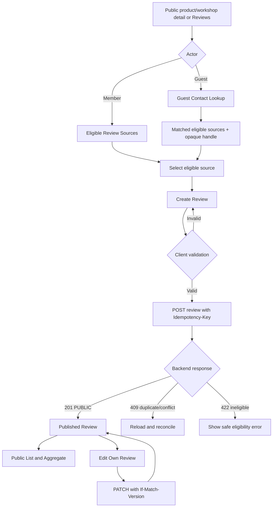
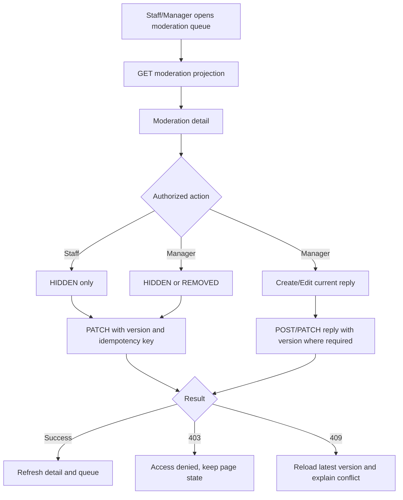

# Feature-011 Frontend UI Flow Design — Review Management

**Date created**: 2026-11-03
**Date updated**: 2026-11-05
**Author**: Ngô Tiến Đạt
**Last updated by**: Ngô Tiến Đạt

## 1. Route and screen inventory

| Screen | Route | Actor | API |
| --- | --- | --- | --- |
| Public Review List | `/reviews` or target-owned embedded route | Guest/Member | `GET /reviews` |
| Public Review Detail | `/reviews/:reviewId` | Guest/Member | `GET /reviews/{reviewId}` |
| Guest Contact Lookup | `/reviews/guest/lookup` | Guest | `POST /review-eligibility/lookup` |
| Eligible Review Sources | `/reviews/eligible-sources` | Member | `GET /reviews/eligible-sources` |
| Create Review | `/reviews/new` | Guest/Member | `POST /reviews` |
| Edit Own Review | `/reviews/:reviewId/edit` | Owner | `GET/PATCH /reviews/{reviewId}` |
| Moderation Queue | `/review-moderation` | Staff/Manager | `GET /review-moderation` |
| Moderation Detail | `/review-moderation/:reviewId` | Staff/Manager | `PATCH /reviews/{reviewId}/visibility` |
| Manager Reply Editor | Embedded in moderation detail | Manager | `POST/PATCH /reviews/{reviewId}/reply` |

The exact public embedding route may be supplied by Product or Workshop pages, but
the Review Management screens must use the same public API projection. No branch
review, Google review write-back, image/video control or notification center is shown.

## 2. Customer flow

Guest lookup response must not expose ineligible transactions. The create command
must use the opaque handle; a raw source identifier is not sufficient.

## 3. Moderation flow

Admin receives only a technical/audit projection when explicitly provided by the
backend. Admin has no business moderation or reply controls.

## 4. Required UI states

- Loading: lookup, source list, public list, detail and command actions.
- Empty: no eligible source, no public review, and empty moderation queue have different messages.
- Validation: contact format, rating `1..5`, text length `≤ 2,000`, required reason/reply fields.
- Pending: disable duplicate commands while retaining form values.
- Success: show the published review or updated moderation/reply state near the completed action.
- Forbidden: show a safe access-denied state; do not sign out on `403`.
- Duplicate/conflict: show source already reviewed, stale version or idempotency conflict and reload/reconcile.
- Network/service failure: preserve recoverable input and expose an explicit retry that reuses the original command key.
- Privacy: public cards show only masked display name and approved review data.

## 5. Responsive and accessibility rules

Customer screens are mobile-first. Moderation screens are desktop-first but collapse
tables/toolbars for smaller screens. Rating controls have accessible names and a
keyboard path. Status uses text plus semantic color. Live regions announce completed
commands and non-routine failures without exposing private source data.

## 6. Figma frame mapping (2026-11-05)

The visual handoff is in Figma file `m5Cyk5rit6lKaX3TPprSow`, section
`F11 · Review Management` (`413:203`). Public list/detail use frames `413:204`
and `416:24`; Guest lookup, Member sources, create and edit use `413:264`,
`413:302`, `413:350` and `413:392`. Staff moderation is represented in section
`414:1083`; Manager moderation/reply is represented in section `414:2983`.
The branch label is not a review target, and these frames do not authorize any
business action beyond the approved API contract. Reviewer approval revision and
date remain required before treating this handoff as final.
