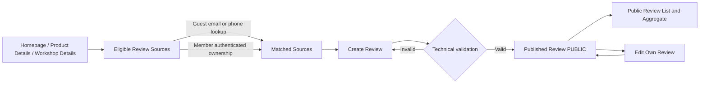
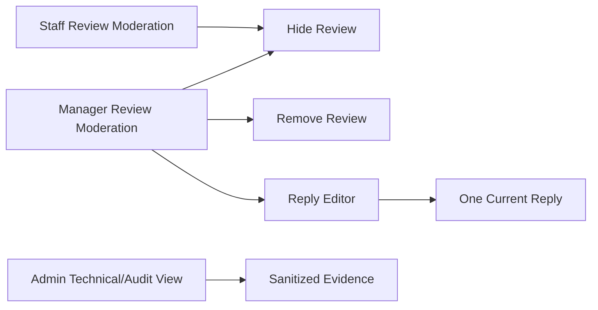

# Feature-011 UI Flow Design

Date created: 2026-11-03  
Date updated: 2026-11-03  
Author: Ngô Tiến Đạt  
Last updated by: Ngô Tiến Đạt

## Public/customer flow

## Operational flow

## Required UI states

- Loading: source lookup/list/detail and mutation actions show non-success progress.
- Empty: no eligible sources, no public reviews, and empty moderation queue have distinct messages.
- Validation: rating required 1–5, text counter and 2,000-character error; contact format error for Guest.
- Forbidden: explain that the current account cannot perform the business action; do not sign the user out merely for 403.
- Conflict: stale version, duplicate source and duplicate reply require reload/reconciliation, not silent retry with a new command.
- Moderation: status and reason are visible to authorized operators; public cards never expose raw contact/source data.
- Featured ordering: feature surfaces may show newest five-star cards first; general filters remain available.

No image/video control, branch-review field, Google review action or notification center is shown in this feature.
