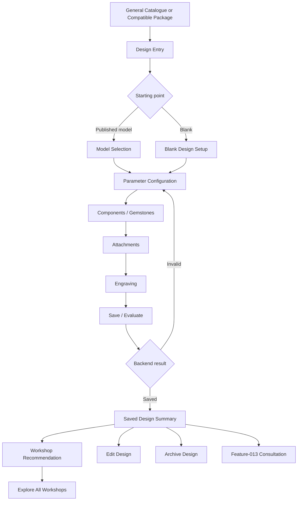

# Feature-012 UI Flow — Workshop Ring Design Configuration

**Date created**: 2026-11-08
**Date updated**: 2026-11-26
**Author**: Ngô Tiến Đạt
**Last updated by**: Phan Sơn

**Status:** Visual baseline approved by the user on 2026-11-22; implementation
remains subject to the feature specification, API and engineering gates.

## Existing-style-first rule

All Feature-012 screens must extend the existing customer journey and shared
frontend visual language before introducing new UI patterns. Reuse the current
page shell, typography, spacing, controls, cards, responsive behavior and
bilingual content conventions. The approved Figma frames are a visual baseline,
not permission to change business rules, API behavior or design lifecycle.

## 1. Routes and screens

| Screen | Proposed route | Actor | Required behavior |
| --- | --- | --- | --- |
| General Ring Design Entry | `/design/rings` | Guest/Member | Show published models across supported design materials and blank design entry; no workshop is selected. |
| General Model Selection | `/design/rings/models` | Guest/Member | Show every active eligible published model, including Copper/Steel; material and score come from the server. |
| Ring Design Entry | `/workshops/:packageReference/design` | Guest/Member | Explain workshop-only scope; Guest may browse and preview locally, while Member may choose model or blank canvas. |
| Model Selection | `/workshops/:packageReference/design/models` | Guest/Member | Show only published models compatible with this package; Guest changes remain local, Member selection creates a new lineage. |
| Blank Design Setup | `/workshops/:packageReference/design/blank` | Guest/Member | Load package-scoped defaults for preview; protected persistence requires Member sign-in. |
| Parameter Configuration | Same design context | Guest/Member | Edit parameters in local preview; only Member may save/evaluate. |
| Component Selection | Same design context | Guest/Member | Preview gemstone types and placement locally; Member commands are validated server-side. |
| Attachment Selection | Same design context | Guest/Member | Preview supported attachments; persistence is Member-only. |
| Engraving Configuration | Same design context | Guest/Member | Preview supported engraving; persistence is Member-only. |
| Evaluation and Summary | `/design/rings/:designId` | Member | Show validation, estimate/difficulty as advisory, summary of stones and current version; retain legacy package route as a redirect when needed. |
| Member Design History | `/my/designs` | Member | Show own current and historical versions; archive unsubmitted designs. |
| Sign-in Required | Same design context | Guest | Explain that saving/evaluating requires Member sign-in without creating server state. |
| Workshop Recommendation | `/design/rings/:designId` | Member | Show material-compatible advisory recommendation or consultation-only outcome; always keep Explore workshops visible. |
| Design Consultation Launch | `/design/rings/:designId` | Member | Open Feature-013 chat with the saved design context; do not expose raw internal identifiers. |

The primary Figma frames are `457:1553` (section), `457:1554` (desktop
configuration), `457:1655` (mobile configuration), `457:1698` (model/blank),
`457:1749` (validation/estimate) and `457:1795` (branch recovery).

## 2. Customer flow

The former Branch Compatibility Recovery and Booking Attachment steps are legacy
documentation. The current flow ends at a saved design and recommendation:

```text
Configure design
→ Save design
→ SAVED summary
→ Show recommendation
→ Edit, archive, consult, or explore any workshop
```



## 3. UI state requirements

- Loading options, design draft and version history.
- Empty published-model catalogue.
- Invalid or incomplete parameter input.
- Inactive/unsupported option returned by backend.
- Saving/evaluating pending state with duplicate command disabled.
- Advisory estimate/difficulty clearly separated from package price/deposit.
- Stale version conflict while preserving unsaved input.
- Guest sign-in required without a protected command.
- Package incompatibility with a clear correction action when a package was selected.
- Forbidden/not-found state without leaking design existence.
- Service unavailable state with explicit retry.

### 3.1 Screen-to-API mapping

| Screen/action | Read/write boundary | Required frontend behavior |
| --- | --- | --- |
| Entry and model/blank selection | `GET /api/v1/workshop-design-options` with optional package filter, then `POST /api/v1/workshop-designs` | Render only server-returned eligible models/options; create one opaque Member design context with an idempotency key. |
| Parameter configuration | Local draft state | Update preview immediately; do not call the backend for every slider movement. |
| Save/Evaluate | `POST /api/v1/workshop-designs/{designId}/versions` or `/evaluate` | Send complete normalized configuration, `Idempotency-Key` and `If-Match-Version`; disable duplicate submission while pending. |
| Evaluation result | Response from Save/Evaluate or `GET /api/v1/workshop-designs/{designId}` | Replace authoritative version and evaluation snapshot only after a successful response. |
| Archive | `POST /api/v1/workshop-designs/{designId}/archive` | Confirm intent, send version header and preserve history in the UI. |
| Workshop discovery | Recommendation projection from the saved-design response | Show the advisory package CTA and exact reason text; keep the Explore Workshops action visible and never force the recommendation. |
| Design consultation | Feature-013 consultation entry with a safe design snapshot | Open a new or existing consultation context with the selected design attached; do not expose internal design IDs or require a booking. |
| Former booking attachment | Retired endpoint/facade | Do not render or call `attach-to-booking`; historical booking-attachment screens are not part of the current flow. |

The exact request and response fields remain owned by
`contracts/workshop-ring-design.openapi.yaml`. The UI must use an adapter to
map DTOs into `PreviewModel` and `DesignViewModel`; components must not consume
raw API DTOs directly.

### 3.2 Visual state matrix

| State | Visual treatment from Figma | Behavior |
| --- | --- | --- |
| Initial loading | Skeleton/neutral preview panel | Disable Save/Evaluate and show no invented options. |
| Model selected | Selected card/pill and populated preview | Include all model default components in the score; filter by package only when one was selected. |
| Blank design | Empty/neutral preview with required-field guidance | Do not allow server Save/Evaluate until required fields are valid. |
| Local changes | Live preview updates; summary may show unsaved indicator | Keep local draft even if a read request fails. |
| Saving/Evaluating | Pending label and disabled duplicate command | Keep the current preview and form data. |
| Validated | Green semantic status and evaluation summary | Show advisory estimate and `rulesVersion` only if returned by API. |
| Invalid | Field-level message beside the control | Preserve unrelated selections and focus the first invalid control. |
| Package incompatible | Safe correction panel | Offer a compatible model or return to general design; do not discard local input. |
| Sign-in required | Existing auth recovery panel | Explain Member requirement; send no protected design command. |
| Stale version/conflict | Conflict notice with reload/reconcile action | Preserve local draft in memory; reload latest server version before retry. |
| Service failure | Error notice and retry | Retry reads normally; retry writes with the original idempotency key. |

## 4. UX and privacy rules

- Mobile-first customer flow; responsive desktop layout follows shared frontend
  baseline.
- Vietnamese/English labels use shared i18n messages.
- Do not show database IDs, Guest session values or private Member data.
- Do not label estimate as payable price or invoice amount.
- Use text and semantic status in addition to color.
- All controls require keyboard access, visible focus and announced validation.
- Parameter changes must show which fields are invalid without silently resetting
  unrelated selections.
- The UI does not infer branch compatibility or authorization locally.

## 5. Integration boundary

Feature-012 receives backend responses through its API adapter and exposes only
an owner-safe design snapshot to approved consultation/reference facades. Its
recommendation links to workshop discovery but creates no booking/payment UI
side effects. General designs do not acquire a package merely by following a
recommendation.

## 6. Visual gate

Figma sections and exact node IDs must be created and approved before frontend
implementation. The Figma revision must be recorded in `version.md` and must not
override the API/spec behavior.

## 7. Review readiness

The screen flow is ready for design review. It must use opaque design
references, server-returned option data and advisory evaluation labels. It must
not display internal IDs, session values, private Member data or estimate as
payable price. Frontend implementation waits for the approved API contract and
Figma revision; no new UI business rule is introduced here.

## 8. Quota, preprocessing and encoding states

- Gemstone summary shows `current / 10`; the add control is disabled at 10 and
  shows a localized explanation.
- Text, symbol and image engraving controls show independent `0/2` counters.
- Each image card includes contrast and sharpness sliders from 0 to 100,
  default 50, with visible value and explanation.
- Configurator and saved-design previews render every collection member. They
  must not reduce the collection to the first text item or a blank image.
- Loading and error placeholders reserve the same preview dimensions as loaded
  content to avoid layout shift.
- All labels and messages use the active locale; mixed-language fallback is
  prohibited.

## 9. Proposed difficulty display and recommendation — 2026-11-26

The saved-design and model-selection screens show the server-returned score and
level without `/10`; the sum has no fixed maximum. The customer UI does not
classify the score or select a package using local constants. On Save/Evaluate
or historical read, it renders the level, recommendation outcome and version
from the same server evaluation snapshot. If the outcome is `TOO_RISKY`, it
shows the safety explanation and consultation/custom-design path without a
recommended workshop button; Explore Workshops remains visible. Wax Casting
continues to show its two-session/two-day note.

An active option without a score in the effective policy remains visible with
disabled selection and a localized explanation that Admin scoring is pending.
A published model can never enter that state: model publication, option
retirement and policy publication are rejected before an active model loses
complete scoring. The frontend uses `selectable` and `unavailableReason` from the
customer options contract and never substitutes a default difficulty score.
All 12 seeded model defaults must be scored with their gemstones and attachments,
including four Copper/Steel models shown in general discovery. Copper/Steel
receive consultation and general workshop discovery without an incompatible
package CTA. Silver Clay advice for an S925 design discloses its S999 workshop
material. Signature Silver 925 mass above 3g shows an advisory excess estimate,
not a disabled design or a payable amount.

An older record with a stored score but no reconstructible historical level or
recommendation shows only that known score and rule version, with no invented
current-policy label. Loading/error states retain the previous local draft and
do not silently replace a historical result with a current calculation. The
Admin editor is specified in [FE-09 UI flow](../../009-administrative-parameter-configuration/design/ui-flow.md),
not in the Member configurator. New visual treatment needs review; the earlier
customer Figma approval does not approve an Admin screen.
