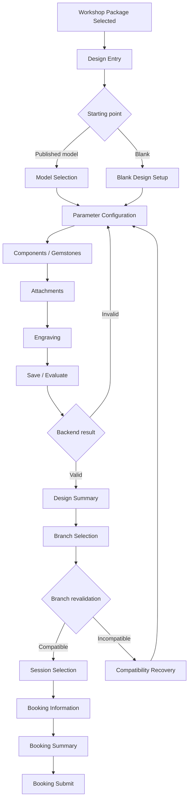

# Feature-012 UI Flow — Workshop Ring Design Configuration

Date created: 2026-11-08
Date updated: 2026-11-14
Author: Ngô Tiến Đạt
Last updated by: Ngô Tiến Đạt

**Status:** Implementation completed and verified across all 5 E2E test scenarios.

## 1. Routes and screens

| Screen | Proposed route | Actor | Required behavior |
| --- | --- | --- | --- |
| Ring Design Entry | `/workshops/:packageReference/design` | Guest/Member | Explain workshop-only scope and choose model (12 models) or blank canvas. |
| Model Selection | `/workshops/:packageReference/design/models` | Guest/Member | Show published models only (minimum 10 models); selecting one creates a new lineage. |
| Blank Design Setup | `/workshops/:packageReference/design/blank` | Guest/Member | Load package-scoped defaults from server. |
| Parameter Configuration | `/workshops/:packageReference/design/configure` | Guest/Member | Edit shape (6 profiles/textures), material (Silver, Copper, Steel), size (6-29 with mm perimeter), thickness slider (1.0-3.0mm), and band width slider (1.5-6.0mm). Synchronously updates Dual View SVG (Top View and Side View). |
| Component Selection | Same design context | Guest/Member | Select gemstone types with steppers `[-] {count} [+]` up to `maxQuantity`, subtotal calculations, and interactive drag-and-drop placement along the ring circle ($R = 85\text{px}$) on the Top View SVG without escaping. |
| Attachment Selection | Same design context | Guest/Member | Select supported attachments and placement. |
| Engraving Configuration | Same design context | Guest/Member | Enter only server-supported engraving content/placement. |
| Evaluation and Summary | `/workshops/:packageReference/design/:designId` | Guest/Member | Show validation, estimate/difficulty as advisory, summary of stones `${quantity}x ${label}`, and current version. |
| Member Design History | `/my/designs` | Member | Show own current and historical versions; archive unsubmitted designs. |
| Guest Session Expired | Same design context | Guest | Explain expiry without exposing internal design data. |
| Branch Compatibility Recovery | Booking transition state | Guest/Member | Explain unsupported option and return to editable design. |

The primary Figma frames are `457:1553` (section), `457:1554` (desktop
configuration), `457:1655` (mobile configuration), `457:1698` (model/blank),
`457:1749` (validation/estimate) and `457:1795` (branch recovery).

## 2. Customer flow

## 3. UI state requirements

- Loading options, design draft and version history.
- Empty published-model catalogue.
- Invalid or incomplete parameter input.
- Inactive/unsupported option returned by backend.
- Saving/evaluating pending state with duplicate command disabled.
- Advisory estimate/difficulty clearly separated from package price/deposit.
- Stale version conflict while preserving unsaved input.
- Guest session expired after 20 minutes inactivity.
- Branch incompatibility with a clear correction action.
- Booking submit failure with design-preserved retry.
- Forbidden/not-found state without leaking design existence.
- Service unavailable state with explicit retry.

### 3.1 Screen-to-API mapping

| Screen/action | Read/write boundary | Required frontend behavior |
| --- | --- | --- |
| Entry and model/blank selection | `GET /api/v1/workshop-design-options`, then `POST /api/v1/workshop-designs` | Render only server-returned models/options; create one opaque design context with an idempotency key. |
| Parameter configuration | Local draft state | Update preview immediately; do not call the backend for every slider movement. |
| Save/Evaluate | `POST /api/v1/workshop-designs/{designId}/versions` or `/evaluate` | Send complete normalized configuration, `Idempotency-Key` and `If-Match-Version`; disable duplicate submission while pending. |
| Evaluation result | Response from Save/Evaluate or `GET /api/v1/workshop-designs/{designId}` | Replace authoritative version and evaluation snapshot only after a successful response. |
| Archive | `POST /api/v1/workshop-designs/{designId}/archive` | Confirm intent, send version header and preserve history in the UI. |
| Branch transition | Booking-owned branch selection plus Feature-012 attach facade | Do not infer compatibility locally; show the recovery frame when backend returns branch incompatibility. |
| Attach/retry | `POST /api/v1/workshop-designs/{designId}/attach-to-booking` or approved facade adapter | Reuse the same operation reference for a retry; never create payment or booking state in the feature client. |

The exact request and response fields remain owned by
`contracts/workshop-ring-design.openapi.yaml`. The UI must use an adapter to
map DTOs into `PreviewModel` and `DesignViewModel`; components must not consume
raw API DTOs directly.

### 3.2 Visual state matrix

| State | Visual treatment from Figma | Behavior |
| --- | --- | --- |
| Initial loading | Skeleton/neutral preview panel | Disable Save/Evaluate and show no invented options. |
| Model selected | Selected card/pill and populated preview | Allow configuration with package-scoped options. |
| Blank design | Empty/neutral preview with required-field guidance | Do not allow server Save/Evaluate until required fields are valid. |
| Local changes | Live preview updates; summary may show unsaved indicator | Keep local draft even if a read request fails. |
| Saving/Evaluating | Pending label and disabled duplicate command | Keep the current preview and form data. |
| Validated | Green semantic status and evaluation summary | Show advisory estimate and `rulesVersion` only if returned by API. |
| Invalid | Field-level message beside the control | Preserve unrelated selections and focus the first invalid control. |
| Branch incompatible | Recovery panel matching node `457:1795` | Offer replace-option or change-branch action; do not discard design. |
| Session expired | Dedicated safe expiry state | Clear unusable session reference and offer restart/login without revealing data. |
| Stale version/conflict | Conflict notice with reload/reconcile action | Preserve local draft in memory; reload latest server version before retry. |
| Service failure | Error notice and retry | Retry reads normally; retry writes with the original idempotency key. |

## 4. UX and privacy rules

- Mobile-first customer flow; responsive desktop layout follows shared frontend
  baseline.
- Vietnamese/English labels use shared i18n messages.
- Do not show database IDs, raw Guest session values or private Member data.
- Do not label estimate as payable price or invoice amount.
- Use text and semantic status in addition to color.
- All controls require keyboard access, visible focus and announced validation.
- Parameter changes must show which fields are invalid without silently resetting
  unrelated selections.
- The UI does not infer branch compatibility or authorization locally.

## 5. Integration boundary

The booking feature passes only the approved package, branch, session and opaque
design context. It does not import Feature-012 repositories or internal state.
Feature-012 receives backend responses through its API adapter and does not
create booking/payment UI side effects.

## 6. Visual gate

Figma sections and exact node IDs must be created and approved before frontend
implementation. The Figma revision must be recorded in `version.md` and must not
override the API/spec behavior.

## 7. Review readiness

The screen flow is ready for design review. It must use opaque design/session
references, server-returned option data and advisory evaluation labels. It must
not display internal IDs, raw session values, private Member data or estimate as
payable price. Frontend implementation waits for the approved API contract and
Figma revision; no new UI business rule is introduced here.
