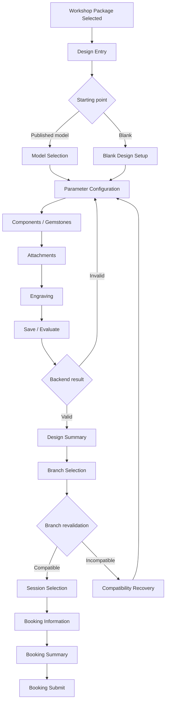

# Feature-012 UI Flow — Workshop Ring Design Configuration

Date created: 2026-11-08  
Date updated: 2026-11-08  
Author: Ngô Tiến Đạt  
Last updated by: Ngô Tiến Đạt  

**Status:** Proposed UI flow; visual baseline and Figma node IDs are not yet
approved.

## 1. Routes and screens

| Screen | Proposed route | Actor | Required behavior |
| --- | --- | --- | --- |
| Ring Design Entry | `/workshops/:packageReference/design` | Guest/Member | Explain workshop-only scope and choose model/blank. |
| Model Selection | `/workshops/:packageReference/design/models` | Guest/Member | Show published models only; selecting one creates a new lineage. |
| Blank Design Setup | `/workshops/:packageReference/design/blank` | Guest/Member | Load package-scoped defaults from server. |
| Parameter Configuration | `/workshops/:packageReference/design/configure` | Guest/Member | Edit shape, material, size and supported details. |
| Component Selection | Same design context | Guest/Member | Select compatible gemstone/components and quantities. |
| Attachment Selection | Same design context | Guest/Member | Select supported attachments and placement. |
| Engraving Configuration | Same design context | Guest/Member | Enter only server-supported engraving content/placement. |
| Evaluation and Summary | `/workshops/:packageReference/design/:designId` | Guest/Member | Show validation, estimate/difficulty as advisory and current version. |
| Member Design History | `/my/designs` | Member | Show own current and historical versions; archive unsubmitted designs. |
| Guest Session Expired | Same design context | Guest | Explain expiry without exposing internal design data. |
| Branch Compatibility Recovery | Booking transition state | Guest/Member | Explain unsupported option and return to editable design. |

## 2. Customer flow

## 3. UI state requirements

- Loading options, design draft and version history.
- Empty published-model catalogue.
- Invalid or incomplete parameter input.
- Inactive/unsupported option returned by backend.
- Saving/evaluating pending state with duplicate command disabled.
- Advisory estimate/difficulty clearly separated from package price/deposit.
- Stale version conflict while preserving unsaved input.
- Guest session expired after 20 minutes inactivity.
- Branch incompatibility with a clear correction action.
- Booking submit failure with design-preserved retry.
- Forbidden/not-found state without leaking design existence.
- Service unavailable state with explicit retry.

## 4. UX and privacy rules

- Mobile-first customer flow; responsive desktop layout follows shared frontend
  baseline.
- Vietnamese/English labels use shared i18n messages.
- Do not show database IDs, raw Guest session values or private Member data.
- Do not label estimate as payable price or invoice amount.
- Use text and semantic status in addition to color.
- All controls require keyboard access, visible focus and announced validation.
- Parameter changes must show which fields are invalid without silently resetting
  unrelated selections.
- The UI does not infer branch compatibility or authorization locally.

## 5. Integration boundary

The booking feature passes only the approved package, branch, session and opaque
design context. It does not import Feature-012 repositories or internal state.
Feature-012 receives backend responses through its API adapter and does not
create booking/payment UI side effects.

## 6. Visual gate

Figma sections and exact node IDs must be created and approved before frontend
implementation. The Figma revision must be recorded in `version.md` and must not
override the API/spec behavior.
