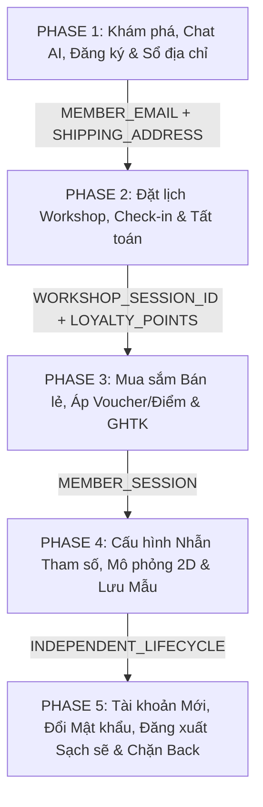

# Master E2E Customer Journey — Bộ Kịch bản Kiểm thử Xuyên suốt Hệ thống PPSWBS trên Mock Prod

**Phiên bản**: 2.0 (Chuẩn hóa Mock Prod Internet) | **Cập nhật**: 2026-11-17  
**Chủ trì**: Senior QA & System Verification Engineer  
**Tiêu chuẩn đối chiếu**: 
- [`AGENT.md`](../AGENT.md) (Quy chuẩn QA & Cổng chất lượng T01 - T10)
- [`spec-general.md`](../../ppswbs-spec/spec-general.md) (Ranh giới nghiệp vụ & Kiến trúc)
- [Constitution](../../ppswbs-spec/.specify/memory/constitution.md) (Baseline bảo mật & RBAC)

---

## 1. Mục tiêu & Định hướng Kiểm thử Mock Prod

Hệ thống PPSWBS đã được triển khai lên môi trường **Mock Prod trên Internet**:
- **Frontend URL**: `https://mland-operations-hub-git-develop-mland-team.vercel.app/`
- **Backend API**: Kết nối thông qua Cloudflare Tunnel (`VITE_API_BASE_URL`).
- **Phương thức kiểm thử**: QA Agent sử dụng `browsermcp` để tương tác trực tiếp trên trình duyệt web, đóng vai trò **Người kiểm định hệ thống độc lập (Black-box / System Observer)**.
- **Trọng tâm kiểm thử**: Ghi nhận và báo cáo các **hiện tượng bất thường (Unexpected Behavior)**, lỗi hiển thị, lỗi đứt gãy luồng nghiệp vụ, sai lệch dữ liệu; **tuyệt đối không can thiệp debug mã nguồn** trên môi trường Mock Prod.

---

## 2. Danh mục "Cái gì KHÔNG test" (Out-of-Scope Boundaries)

Để bảo đảm tính toàn vẹn và ổn định của môi trường Mock Prod, bộ kịch bản tuân thủ nghiêm ngặt 5 nguyên tắc:

1. **Tuyệt đối cấm giao dịch tiền thật / thẻ thật:** Mọi giao dịch cọc và thanh toán chỉ được sử dụng tài khoản thử nghiệm VNPay Sandbox theo định danh cố định.
2. **Không kiểm thử tải / spam request (No DDoS / Stress test):** Không thực hiện click đúp liên tục quá mức, spam request làm nghẽn tunnel hoặc cạn kiệt quota AI / Firebase.
3. **Không xóa hoặc làm bẩn dữ liệu Master gốc:** Không xóa các chi nhánh xưởng mẫu (Hoàn Kiếm, Quận 1), không xóa các danh mục sản phẩm, gói workshop cốt lõi.
4. **Không kiểm tra hộp thư email thực tế bên ngoài:** Bỏ qua bước kiểm tra mở hộp thư Gmail/Yahoo thật của người dùng bên thứ ba.
5. **Không debug mã nguồn:** Khi gặp lỗi, QA Agent chỉ ghi nhận bằng chứng (URL, thao tác thực tế, screenshot, console error, HTTP payload) vào báo cáo Unexpected Finding và bàn giao cho đội phát triển.

---

## 3. Ma trận Tài khoản & Phân quyền trên Mock Prod

| Vai trò (Actor) | Phương thức xác thực | Thông tin tài khoản | Trình duyệt / Ngữ cảnh | Phạm vi nghiệp vụ |
| :--- | :--- | :--- | :--- | :--- |
| **MEMBER** (Hội viên) | **Google Sign-In** (khi đăng nhập) Email/Password tự do (khi đăng ký mới) | `minikie456@gmail.com` | **Browser 1 (Client View)** Màn hình Laptop (1280x800) hoặc Mobile (390x844) | Lướt catalog, chat AI, đăng ký tài khoản, cấu hình nhẫn 3D, cọc VNPay, mua hàng bán lẻ, nộp yêu cầu thiết kế riêng, viết Review. |
| **STAFF** (Nhân viên xưởng) | Email & Password | • Mail: `staff.test@mland.vn` • Pass: `StaffTest@123456` | **Browser 2 (Backstage View)** Cửa sổ Ẩn danh (Incognito) | Quét QR/nhập mã vé check-in học viên tại xưởng (`003.2`), đóng gói đơn hàng & bàn giao vận chuyển GHTK (`008`). |
| **MANAGER** (Quản lý xưởng) | Email & Password | • Mail: `manager.test@mland.vn` • Pass: `ManagerTest@123456` | **Browser 2 (Backstage View)** Cửa sổ Ẩn danh (Incognito) | Xuất Hóa đơn tất toán phụ phí workshop (`003.3`), thẩm định & duyệt báo giá nhẫn độc bản (`004`), duyệt & phản hồi Review công khai (`011`). |

---

## 4. Dữ liệu Thử nghiệm Thanh toán VNPay Sandbox

Mọi thao tác thanh toán trong kịch bản sử dụng thông tin thẻ thử nghiệm cổng VNPay:
- **Ngân hàng (Bank)**: `NCB`
- **Số thẻ**: `9704198526191432198`
- **Tên chủ thẻ**: `NGUYEN VAN A`
- **Ngày phát hành**: `07/15`
- **Mã OTP**: `123456`

---

## 5. Quy chế Dừng Kiểm thử (Stop Conditions & Abort Triggers)

| Mức độ | Định nghĩa sự cố | Hành vi xử lý của QA Agent |
| :--- | :--- | :--- |
| **HARD STOP** *(Dừng ngay kịch bản)* | • Màn hình trắng (White Screen of Death / Unhandled React Crash). • Lỗi vòng lặp điều hướng (Route Guard Redirect Loop) không thoát được. • Lỗi HTTP 5xx tại API trọng yếu (không tạo được đơn hàng, không lấy được link thanh toán VNPay, không load được ca học). • Nút bấm submit bị khóa vô lý hoặc giao diện đơ cứng hoàn toàn không thể tương tác. • Mất kết nối mạng / sập Cloudflare Tunnel. | **DỪNG NGAY LẬP TỨC** ca kiểm thử tại bước lỗi. Chụp ảnh màn hình hiện trạng, trích xuất console errors và network request. Cập nhật trạng thái `BLOCKED` hoặc `FAIL`, ghi nhận vào `BUG-LOG.md` và dừng các bước tiếp theo để tránh dây chuyền dữ liệu bị hỏng. |
| **SOFT FAIL** *(Ghi nhận & Chạy tiếp)* | • Sai lệch nội dung nhãn text, lỗi chính tả, sai bản dịch VI/EN. • Lệch vị trí giao diện nhẹ, vỡ icon, không hiển thị ảnh thumbnail nhưng không che nút thao tác. • Dữ liệu số liệu hiển thị phụ lệch nhẹ nhưng form vẫn submit thành công và luồng chính vẫn tiếp tục được. | Chụp ảnh màn hình bằng chứng, ghi nhận cảnh báo **Unexpected Behavior (Minor/Major)** vào báo cáo, tiếp tục thực hiện các bước tiếp theo của kịch bản. |

---

## 6. Ma trận Dây chuyền Dữ liệu (Data Chaining Matrix)

| Pha | Tên kịch bản | Dữ liệu đầu vào (Input) | Dữ liệu đầu ra bàn giao (Output Handoff) |
| :---: | :--- | :--- | :--- |
| **1** | [`JOURNEY-PHASE-1`](JOURNEY-PHASE-1--guest-discovery-and-onboarding.md) | Truy cập trực tiếp Mock Prod | • `MEMBER_EMAIL` (minikie456@gmail.com hoặc mail đăng ký mới) • `SHIPPING_ADDRESS_ID` (Địa chỉ 2 cấp tại Hà Nội) |
| **2** | [`JOURNEY-PHASE-2`](JOURNEY-PHASE-2--workshop-booking-and-fulfillment.md) | `MEMBER_EMAIL` từ Pha 1 | • `WORKSHOP_TICKET_CODE` • `WORKSHOP_SESSION_ID` • `LOYALTY_POINTS_EARNED` (+Điểm thưởng hoàn thành) |
| **3** | [`JOURNEY-PHASE-3`](JOURNEY-PHASE-3--retail-loyalty-and-fulfillment.md) | `MEMBER_EMAIL` + `SHIPPING_ADDRESS_ID` + `LOYALTY_POINTS` | • `RETAIL_ORDER_ID` • `TRACKING_CODE_GHTK` • `RETAIL_PRODUCT_ID` |
| **4** | [`JOURNEY-PHASE-4`](JOURNEY-PHASE-4--custom-design-and-manufacturing.md) | `MEMBER_EMAIL` từ Pha 1 hoặc khách mới | • `DESIGN_ID` (Mẫu nhẫn đã thẩm định & lưu trữ) • `SAVED_DESIGN_CARD` trong `/my/designs` |
| **5** | [`JOURNEY-PHASE-5`](JOURNEY-PHASE-5--reviews-and-account-lifecycle.md) | Độc lập (Tự sinh tài khoản mới qua form đăng ký) | • `NEW_USER_EMAIL` + `NEW_PASSWORD` • Trạng thái phiên đã dọn sạch (`CLEAN_LOGOUT`) • Bằng chứng kiểm chứng `SessionNavigationBoundary` chặn Back |

---

## 7. Danh sách Tập tin Kịch bản Chi tiết

1. **[JOURNEY-PHASE-1: Khám phá Trang chủ, Tương tác Chat AI, Đăng ký Hội viên & Thiết lập Sổ địa chỉ](JOURNEY-PHASE-1--guest-discovery-and-onboarding.md)**
2. **[JOURNEY-PHASE-2: Đặt Lịch Workshop, Cấu hình Nhẫn 3D, Cọc VNPay, Check-in Xưởng & Tất toán Hóa đơn](JOURNEY-PHASE-2--workshop-booking-and-fulfillment.md)**
3. **[JOURNEY-PHASE-3: Mua sắm Bán lẻ, Áp Voucher & Tiêu Điểm Loyalty, Thanh toán VNPay & Bàn giao Vận chuyển](JOURNEY-PHASE-3--retail-loyalty-and-fulfillment.md)**
4. **[JOURNEY-PHASE-4: Khám phá Cấu hình Nhẫn Workshop, Mô phỏng 2D Trực quan, Thẩm định Kỹ thuật & Sổ tay Thiết kế Độc bản](JOURNEY-PHASE-4--custom-design-and-manufacturing.md)**
5. **[JOURNEY-PHASE-5: Quản trị Tài khoản & Đổi Mật khẩu Mới, Thử thách Đăng xuất Sạch sẽ & Rào cản Điều hướng Đối nghịch](JOURNEY-PHASE-5--reviews-and-account-lifecycle.md)**
