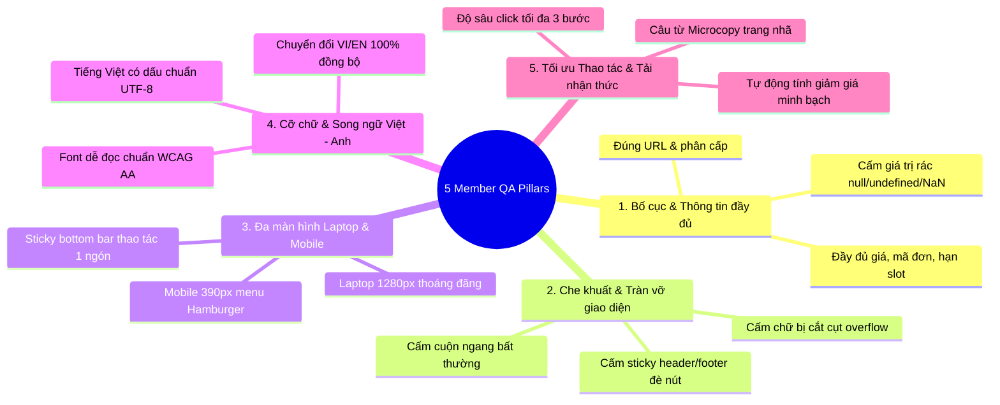

# Master E2E Customer Journey — Bộ Kịch bản Kiểm thử Xuyên suốt Toàn Hệ thống PPSWBS

**Phiên bản**: 1.0 | **Ngày ban hành**: 2026-11-14  
**Chủ trì**: Senior QA & System Verification Engineer  
**Tiêu chuẩn đối chiếu**: 
- [`AGENT.md`](../AGENT.md) (Quy chuẩn QA & Cổng chất lượng T01 - T10)
- [`spec-general.md`](../../ppswbs-spec/spec-general.md) (Ranh giới nghiệp vụ & Kiến trúc)
- [Constitution](../../ppswbs-spec/.specify/memory/constitution.md) (Baseline bảo mật & RBAC cố định)

---

## 1. Giới thiệu & Mục tiêu (Purpose)

Bộ kịch bản **Master E2E Customer Journey** được xây dựng nhằm mô phỏng và kiểm chứng 100% dòng đời thực tế của một người dùng trong hệ sinh thái xưởng kim hoàn Mland Atelier:
- Khởi đầu từ một khách vãng lai (**GUEST**) lướt web tìm hiểu sản phẩm và workshop, tương tác với AI tư vấn.
- Quyết định đăng ký tài khoản và hoàn thiện hồ sơ để trở thành Hội viên chính thức (**MEMBER**).
- Trải nghiệm toàn diện dịch vụ chế tác nhẫn tại xưởng: Đặt lịch, cấu hình mẫu nhẫn 3D, cọc VNPay, nhận vé QR, điểm danh check-in tại xưởng với **STAFF**, phát sinh phụ phí và tất toán hóa đơn với **MANAGER**, tích lũy điểm thưởng Hội viên.
- Sử dụng điểm thưởng và mã ưu đãi để mua sắm bán lẻ nhẫn chế tác sẵn, thanh toán VNPay và được Staff đóng gói bàn giao qua GHTK.
- Yêu cầu đặt làm nhẫn riêng độc bản theo hình ảnh tự cung cấp, được AI phân tích và Quản lý thẩm định duyệt giá.
- Khép kín vòng đời bằng việc gửi bài đánh giá Review công khai, đổi mật khẩu an toàn và đăng xuất sạch sẽ.

---

## 2. Mô hình Vận hành 2 Trình duyệt Song song (Dual-Browser Matrix)

Để tái hiện chân thực sự phối hợp thời gian thực giữa Khách hàng và Đội ngũ xưởng kim hoàn mà không gây xung đột phiên (session collision):

```text
┌─────────────────────────────────────────────────────────┐     ┌─────────────────────────────────────────────────────────┐
│              BROWSER 1 (Khách hàng / Client)            │     │          BROWSER 2 (Đội ngũ Nội bộ / Backstage)         │
│  • Cửa sổ trình duyệt thường (Chế độ Laptop hoặc Mobile)│     │  • Cửa sổ Ẩn danh (Incognito) hoặc User Profile riêng   │
│  • Đóng vai: GUEST ➔ MEMBER                             │     │  • Đóng vai: STAFF (Điểm danh/Đóng gói)                 │
│  • Hành vi: Khám phá, Đặt chỗ, Mua hàng, Thanh toán     │     │              MANAGER (Duyệt giá/Hóa đơn/Review)         │
└────────────────────────────────────────────┬────────────┘     └────────────────────────────┬────────────────────────────┘
                                             │                                               │
                                             ▼                                               ▼
                         ┌───────────────────────────────────────────────────────────────────────┐
                         │              HỆ THỐNG PPSWBS BACKEND (SPRING MODULITH :8080)          │
                         │              • MySQL Flyway Database (V145+)                          │
                         │              • Cổng Thanh toán VNPay Sandbox                          │
                         │              • Firebase Authentication & SMTP Mail Gateway            │
                         └───────────────────────────────────────────────────────────────────────┘
```

| Môi trường | Vai trò | Viewport kiểm thử | Mục đích & Trách nhiệm chính |
| :--- | :--- | :--- | :--- |
| **Browser 1** | `GUEST` ➔ `MEMBER` | • **Laptop**: 1280 x 800 px<br>• **Mobile Phone**: 390 x 844 px (iPhone Emulation) | Lướt catalog, chat AI, đăng ký tài khoản, cấu hình nhẫn, cọc VNPay, giỏ hàng, nộp ảnh thiết kế riêng, viết Review. |
| **Browser 2** | `STAFF` | • **Laptop**: 1440 x 900 px | Quét mã QR check-in học viên tại xưởng (`003.2`), đóng gói đơn hàng & bàn giao GHTK (`008`). Phải gán đúng `workshopLocationId = 1`. |
| **Browser 2** | `MANAGER` | • **Laptop**: 1440 x 900 px | Xuất Hóa đơn tất toán phụ phí workshop (`003.3`), duyệt báo giá nhẫn độc bản (`004`), duyệt & phản hồi Review công khai (`011`). |

---

## 3. Ma trận Dây chuyền Dữ liệu (Data Fixture Chaining Matrix)

Dữ liệu đầu ra của Pha trước là tài sản đầu vào không thể thiếu của Pha sau:

| Pha | Tên kịch bản | Dữ liệu đầu vào (Input Dependencies) | Thao tác chính sinh dữ liệu | Dữ liệu đầu ra bàn giao (Output Handoff) |
| :---: | :--- | :--- | :--- | :--- |
| **1** | [`JOURNEY-PHASE-1`](JOURNEY-PHASE-1--guest-discovery-and-onboarding.md) | Không (Bắt đầu từ con số 0) | Đăng ký Firebase Auth + Backend kích hoạt `MEMBER` + Thêm địa chỉ nhận hàng | • `MEMBER_EMAIL`<br>• `MEMBER_UID`<br>• `SHIPPING_ADDRESS_ID` |
| **2** | [`JOURNEY-PHASE-2`](JOURNEY-PHASE-2--workshop-booking-and-fulfillment.md) | `MEMBER_EMAIL` từ Pha 1 | Đặt gói workshop, cọc VNPay, Staff quét vé check-in, Manager xuất Final Bill tất toán | • `WORKSHOP_TICKET_CODE`<br>• `WORKSHOP_SESSION_ID`<br>• `LOYALTY_POINTS_EARNED` (+50 pts) |
| **3** | [`JOURNEY-PHASE-3`](JOURNEY-PHASE-3--retail-loyalty-and-fulfillment.md) | `MEMBER_EMAIL` + `SHIPPING_ADDRESS_ID` (P1) + `LOYALTY_POINTS` (P2) | Mua nhẫn sẵn, áp voucher + tiêu 50 điểm loyalty, thanh toán VNPay, Staff bàn giao GHTK | • `RETAIL_ORDER_ID`<br>• `TRACKING_CODE_GHTK`<br>• `RETAIL_PRODUCT_ID` |
| **4** | [`JOURNEY-PHASE-4`](JOURNEY-PHASE-4--custom-design-and-manufacturing.md) | `MEMBER_EMAIL` từ Pha 1 | Tải ảnh phác thảo, AI tham vấn, Manager định giá 3tr, Member cọc 50% qua VNPay | • `DESIGN_REQUEST_ID`<br>• `CUSTOM_ORDER_ID` |
| **5** | [`JOURNEY-PHASE-5`](JOURNEY-PHASE-5--reviews-and-account-lifecycle.md) | `WORKSHOP_SESSION_ID` (P2) + `RETAIL_PRODUCT_ID` (P3) + `MEMBER_EMAIL` | Viết review 5 sao cho Workshop & Nhẫn, Manager duyệt & phản hồi, đổi mật khẩu & đăng xuất | • `REVIEW_WORKSHOP_ID`<br>• `REVIEW_PRODUCT_ID`<br>• Trạng thái phiên đã dọn sạch |

---

## 4. Bộ 5 Trụ Cột Đánh Giá Trải Nghiệm Hội Viên (5 Strict Member UX/UI Pillars)

Theo yêu cầu nghiêm ngặt của Senior QA, mọi kịch bản của Member phải được đối chiếu qua 5 trụ cột sau tại phần Expected Assertions:



---

## 5. Danh sách Tập tin Kịch bản Chi tiết

| Tập tin kịch bản | Mô tả tóm tắt | Vai trò tương tác | Ca thử thách đối nghịch (Adversarial) |
| :--- | :--- | :--- | :--- |
| **[`JOURNEY-PHASE-1`](JOURNEY-PHASE-1--guest-discovery-and-onboarding.md)** | Khám phá Danh mục, Chat AI, Đăng ký Hội viên & Cập nhật Hồ sơ | `GUEST` ➔ `MEMBER` | Nhập pass yếu + Vượt rào route guard `/profile` khi chưa đăng nhập. |
| **[`JOURNEY-PHASE-2`](JOURNEY-PHASE-2--workshop-booking-and-fulfillment.md)** | Đặt Workshop, Cấu hình nhẫn 3D, Cọc VNPay, Staff Check-in, Tất toán & Tích điểm | `MEMBER` + `STAFF` + `MANAGER` | Hủy cọc tại cổng VNPay Sandbox + Quét thử mã vé giả mạo tại xưởng. |
| **[`JOURNEY-PHASE-3`](JOURNEY-PHASE-3--retail-loyalty-and-fulfillment.md)** | Mua nhẫn bán lẻ, Áp Voucher + Tiêu điểm Loyalty, VNPay, Bàn giao GHTK | `MEMBER` + `STAFF` | Nhập voucher giả + Nhập tiêu điểm loyalty vượt quá số dư hiện có. |
| **[`JOURNEY-PHASE-4`](JOURNEY-PHASE-4--custom-design-and-manufacturing.md)** | Yêu cầu Thiết kế Nhẫn riêng, AI tham vấn, Manager duyệt giá, Cọc sản xuất | `MEMBER` + `MANAGER` | Tải file sai định dạng/dung lượng quá 10MB lên cổng yêu cầu. |
| **[`JOURNEY-PHASE-5`](JOURNEY-PHASE-5--reviews-and-account-lifecycle.md)** | Đánh giá dịch vụ, Quản lý phê duyệt & phản hồi, Đổi mật khẩu & Đăng xuất | `MEMBER` + `MANAGER` | Cố tình submit review cho sản phẩm/workshop chưa từng mua. |

---

## 6. Hướng dẫn Khởi chạy Kiểm thử Thực tế (Quickstart Guide)

1. **Khởi động Môi trường**:
   - Backend: `http://localhost:8080` (Xem hướng dẫn tại [`RUN-PROJ-DEV.md`](../RUN-PROJ-DEV.md)).
   - Frontend: `http://localhost:5173` (`npm run dev`).
2. **Khởi động 2 Trình duyệt**:
   - Mở **Browser 1**: Trình duyệt chính, điều hướng tới `http://localhost:5173`.
   - Mở **Browser 2**: Cửa sổ ẩn danh (Ctrl + Shift + N) hoặc Profile riêng, điều hướng tới `http://localhost:5173/login`.
3. **Thực thi tuần tự**:
   - Chạy lần lượt từ `JOURNEY-PHASE-1` đến `JOURNEY-PHASE-5`.
   - Ghi nhận lỗi phát hiện được vào [`BUG-LOG.md`](../BUG-LOG.md).
